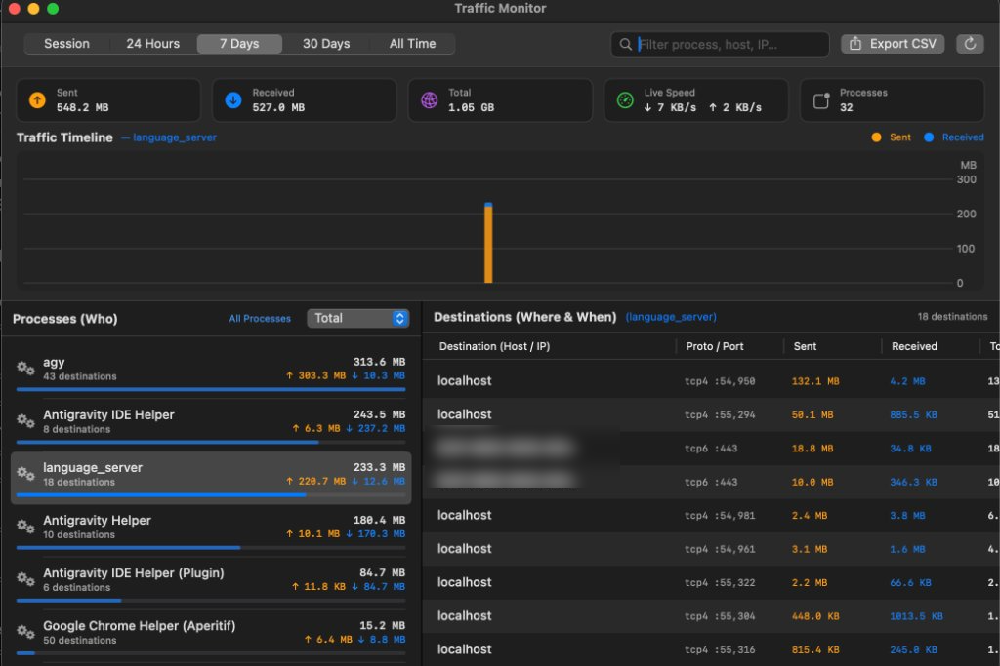

# macOS Traffic Monitor (`Traffic Monitor.app`)

A lightweight, 100% native **macOS Menu Bar & Dashboard app** that monitors internet traffic per process, per destination (IP & resolved hostname), and over time — with persistent SQLite history for **Session**, **24 Hours**, **7 Days**, **30 Days**, and **All Time**.



## Features

- **100% Native macOS `.app` Bundle (Zero Dependencies)**:
  - Compiled natively with Swift (`AppKit` + `SwiftUI` + `Charts` + `SQLite3`, Universal Binary for `arm64` & `x86_64`).
  - Runs without root privileges using macOS `nettop` and `getnameinfo`.
  - Lives quietly in the top menu bar (`🌐 ↓1.2 MB/s ↑340 KB/s`).
- **Who, Where, When & How Much**:
  - **Who**: Traffic is summed by process name across all PIDs, with native app icons.
  - **Where**: Remote IP, asynchronously resolved hostname (cached in SQLite), port, and protocol (`tcp4`, `tcp6`, `udp4`, `quic6`, etc.).
  - **When**: First seen & last active timestamps for every destination, plus interactive **hourly (24h)** and **daily (7d / 30d)** timeline charts.
  - **Internet Only Filter**: Excludes loopback (`127.0.0.1`, `::1`) and local LAN (`192.168.x.x`, `10.x.x.x`, `172.16-31.x.x`, `fe80::`) traffic by default.
- **Detailed Statistics Window**:
  - Timeframe selector: **Session**, **24 Hours**, **7 Days**, **30 Days**, **All Time**.
  - Search/filter by process name, hostname, IP, or port.
  - Sort processes by Total, Sent ↑, Received ↓, or Name.
  - Export filtered traffic data to **CSV**.
- **Multilingual (EN / RU)**:
  - Automatically adapts to macOS system language, with manual toggle in the menu bar.

## Building from Source

Requires macOS 13.0+ with Xcode Command Line Tools (`swiftc`):

```bash
chmod +x build_app.sh
./build_app.sh
```

This compiles `macos/*.swift` into a Universal Binary (`arm64` + `x86_64`) and generates **`Traffic Monitor.app`**.

## Data Storage

- Configuration: `~/.config/traffic-monitor/config.json`
- Traffic history & DNS cache: `~/.config/traffic-monitor/traffic.db`
